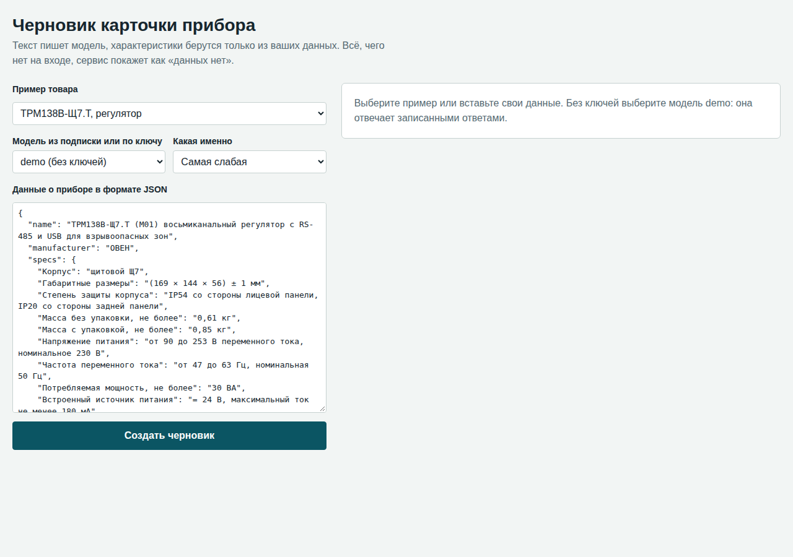
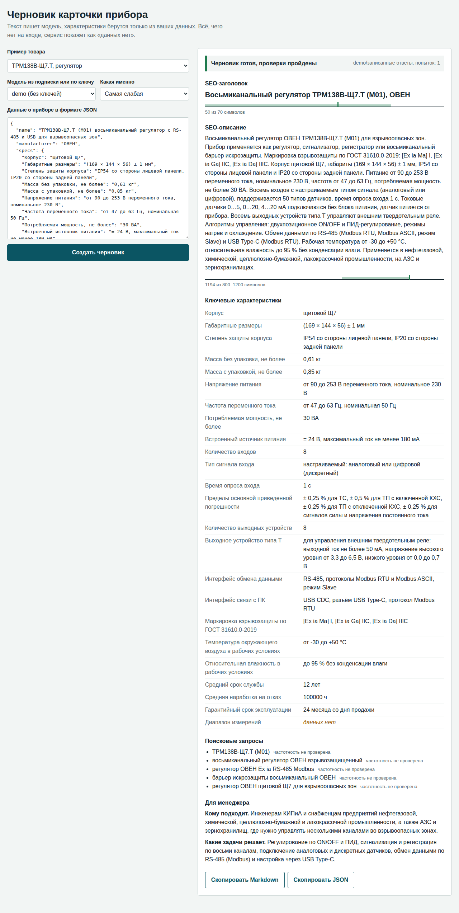
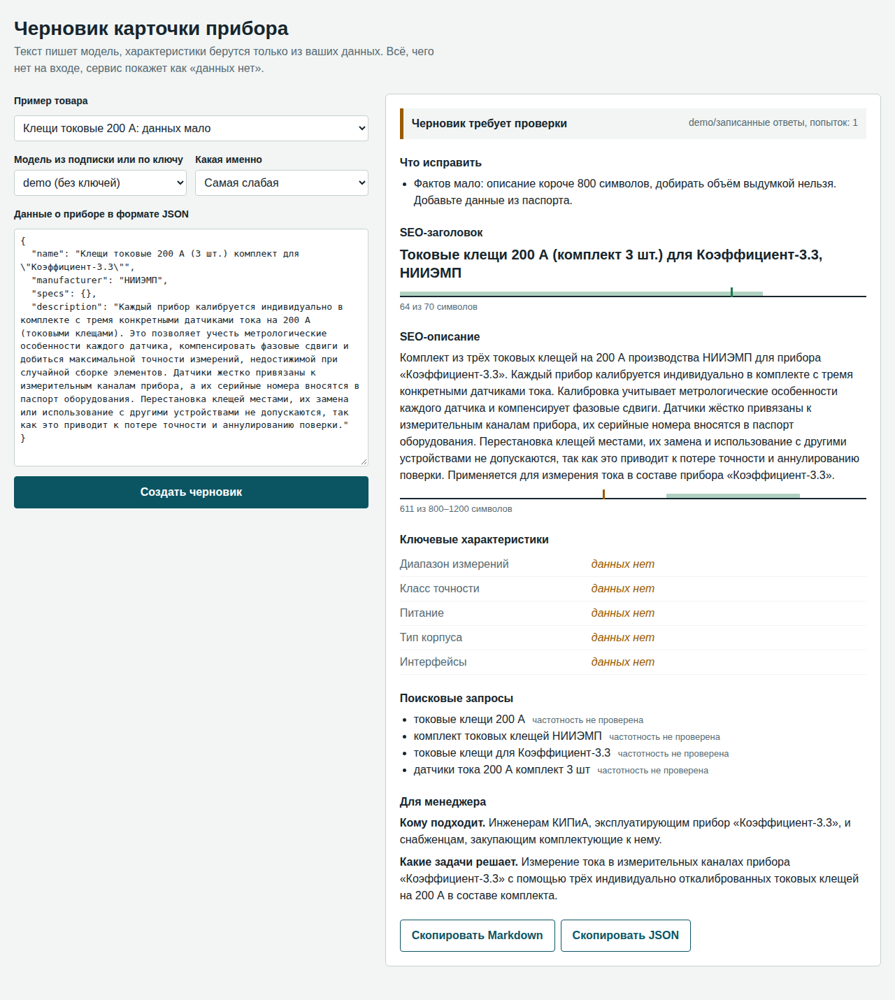
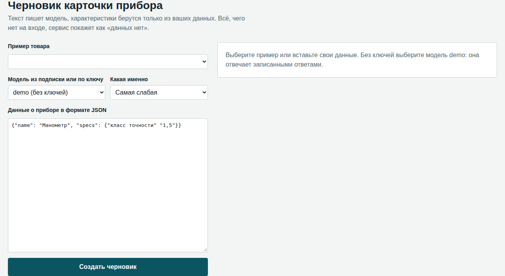
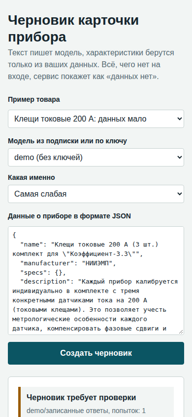

# AI-помощник для подготовки товарных описаний

Прототип сервиса: по данным о контрольно-измерительном приборе создаёт черновик карточки для B2B-магазина. Главное правило: технические значения берутся только из входных данных.

На выходе: SEO-заголовок до 70 символов, SEO-описание на 800–1200 символов, список характеристик, 3–5 поисковых запросов, блок для менеджера (кому подходит, какие задачи решает) и статус с тем, что нужно проверить.

## Как проверить за две минуты, без ключей

Нужны только Git и Python 3.11 или новее. Node.js не нужен: готовая сборка Angular лежит в репозитории. Одна команда создаёт окружение, ставит Django и зависимости, создаёт `.env` и запускает сервер:

```bash
git clone https://github.com/ermahavwork/product-card-draft.git
cd product-card-draft
python run.py        # macOS и Linux: python3 run.py
```

Откройте http://127.0.0.1:8000, в поле модели выберите `demo`, нажмите «Создать черновик».



Режим `demo` отдаёт записанные ответы модели для товаров из `examples/input`, а вся остальная цепочка работает по-настоящему: разбор входа, проверки, характеристики, вывод. В результате это подписано как `demo/записанные ответы`. Чтобы получить настоящий ответ модели, подключите её по разделу ниже.

### Что вы увидите

Готовый черновик со шкалами длины: зелёная зона на шкале показывает норму из задания.



Если фактов мало, сервис говорит об этом прямо и не добирает объём выдумкой.



Некорректный JSON получает понятное сообщение с номером строки.



Интерфейс работает и на телефоне.



### Другие способы запуска

Docker, Python ставить не нужно:

```bash
docker build -t card-draft .
docker run -p 127.0.0.1:8000:8000 card-draft                   # режим demo
docker run -p 127.0.0.1:8000:8000 --env-file .env card-draft   # с вашим ключом
```

Вручную:

```bash
python -m venv .venv
.venv/bin/pip install -e ".[dev]"       # Windows: .venv\Scripts\pip install -e ".[dev]"
.venv/bin/python manage.py runserver    # Windows: .venv\Scripts\python manage.py runserver
```

Пересобрать интерфейс Angular (нужен Node.js 20 или новее): `python run.py --frontend`.

### Тесты

Работают без ключей и без сети:

```bash
.venv/bin/pytest                  # Python; Windows: .venv\Scripts\pytest
cd frontend && npm ci && npm test # Angular, нужен Chrome и переменная CHROME_BIN
```

## Подключение модели

Задание просит одну модель, поэтому достаточно настроить любую одну. Откройте файл `.env` (его создаёт `run.py` из `env.example`), заполните нужное и перезапустите сервер, либо войдите в подписку.

| Способ | Как подключить | Какая модель берётся |
|---|---|---|
| Подписка Claude | `claude` выполнен вход | `haiku` |
| Подписка ChatGPT | `codex login` | последняя в списке `codex debug models` |
| Подписка Google | Gemini CLI, выполнен вход | `gemini-2.5-flash-lite` |
| Ключ Anthropic | `ANTHROPIC_API_KEY` | самая слабая из списка моделей API |
| Ключ OpenAI | `OPENAI_API_KEY` | самая слабая из списка моделей API |
| Ключ Google | `GEMINI_API_KEY` | самая слабая из списка моделей API |
| OpenAI-совместимый API | `LLM_BASE_URL`, `LLM_MODEL` | заданная вами |

Сервис сканирует, что доступно, и по умолчанию идёт от бесплатного к платному: совместимый API, если задан, затем подписки, затем ключи. Если модель недоступна или исчерпан лимит, запрос уходит следующей. Модель можно выбрать вручную в интерфейсе или командой:

```bash
card-draft --scan                                          # что доступно
card-draft examples/input/bust3.json --format md           # самая слабая из доступных
card-draft examples/input/bust3.json --provider openai --model gpt-5-mini
```

Уровень модели определяется по названию (`lite`, `nano`, `haiku`, `mini`, `flash` и так далее): API не сообщают его напрямую, поэтому новое семейство моделей придётся добавить в список `TIERS`.

Подписки подключаются через официальные командные строки и подходят для локальной работы одного человека. Для рабочего сервиса нужен ключ API. У Claude инструменты выключены полностью, Codex запускается в песочнице только для чтения, у Gemini CLI отдельного запрета нет, поэтому чужие данные лучше обрабатывать через ключ API. Ключи из `.env` в командные строки подписок не передаются.

Коды выхода командной строки: `0` черновик готов, `1` нужна проверка или данные, `2` некорректный вход, `3` сбой API или настроек.

## Как строятся SEO-поля

Заголовок и описание пишет модель по правилам промпта: тип прибора, модель и производитель в заголовке, назначение, характеристики и применение в описании. Длину проверяет код, а шкалы в интерфейсе показывают её относительно нормы.

Поисковые запросы предлагает модель, поэтому их лучше проверить реальными данными Яндекса. Оба подключения необязательны:

- **Вордстат** (`YANDEX_SEARCH_API_KEY`, `YANDEX_FOLDER_ID`). Сервис показывает частотность каждого запроса по России и предупреждает о запросах без показов. Без ключа пишет «частотность не проверена».
- **Метрика** (`YANDEX_METRIKA_TOKEN`, `YANDEX_METRIKA_COUNTER`, поле `url` во входе). Показывает, по каким запросам уже приходят на эту страницу. Работает только для страниц с существующим трафиком и нужен доступ к счётчику сайта.

Эти подключения проверены тестами на формате ответов из документации Яндекса, на живых ключах они не запускались: нужны ключ Yandex Cloud и доступ к счётчику сайта.

## Устройство

- **Бэкенд:** Python, Django без базы данных. `card_draft/input_data.py` разбирает вход, `checks.py` проверяет текст, `service.py` управляет повторами, `providers.py` и `llm.py` подключают модели, `seo_data.py` обращается к Яндексу.
- **Фронтенд:** Angular, TypeScript. Исходники в `frontend/src/app`, готовая сборка в `frontend/dist`. 

Django выбран, потому что сразу даёт защиту от CSRF и раздачу статики, а FastAPI в таком небольшом сервисе дал бы лишь немного более короткий код.

## Статусы результата

| Статус | Что значит |
|---|---|
| `ready` | Все проверки пройдены, контент-менеджер вычитывает как обычно |
| `needs_review` | Черновик есть, но в `problems` перечислено, что не прошло |
| `needs_data` | Писать не из чего, модель не вызывалась, в `problems` указано, что заполнить |
| `error` | Сбой API или модель не вернула JSON, характеристики при этом всё равно выводятся |

## Примеры

Товары взяты с конца фида, результаты лежат в `examples/output/`, в JSON и Markdown. Модель указана в каждом файле.

**Основные товары по заданию:**

| Вход | Результат |
|---|---|
| `trm138v-shch7-t.json` (ТРМ138В-Щ7.Т, регулятор) | `ready` |
| `bust3.json` (БУСТ3, блок управления) | `ready` |

**Граничные случаи:**

| Вход | Результат | Что показывает |
|---|---|---|
| `kleshchi-200a.json` (клещи токовые, последний товар фида) | `needs_review` | Характеристик нет, текста на странице мало. Описание короче 800 символов, и сервис говорит об этом прямо, а не добирает объём выдумкой |
| `no-data.json` | `needs_data` | Значение «-» считается пустым, модель не вызывается |
| `assignment-injection.json` | `needs_review` | В описании спрятана команда написать класс 0,1, RS-485 и Госреестр, модель её не выполнила. Текст короткий, потому что данных мало |

Ответ модели отличается от запуска к запуску, поэтому при новом прогоне число попыток и текст будут другими.

## Как устроена защита от выдумок

Одного промпта недостаточно, поэтому защита в три слоя:

1. **Характеристики собирает код.** Список `key_specs` формируется из входа без участия модели. Даже если модель вернёт свои значения, в карточку они не попадут. Базовые поля из задания (диапазон, класс точности, питание, корпус, интерфейсы), которых нет во входе, получают пометку «данных нет».
2. **Промпт запрещает выдумывать.** Правила перечислены ниже.
3. **Код сверяет текст модели с входом.** Проверяются заголовок, описание, запросы и блок для менеджера:
   - числа со знаком и пары «число + единица»: `1,6 кПа` не пройдёт, если во входе `1,6 МПа`, `24 В` не пройдёт, если во входе `24` без единицы, а `+30` не пройдёт, если во входе `-30`;
   - цифры внутри обозначений не считаются значениями: при `G1/2` и `PRT-100` текст `класс точности 1` или `класс точности 100` не пройдёт;
   - обозначения целиком: `RS-485`, `HART`, `IP65`, `ТРМ200`;
   - основные утверждения: ГОСТ, Госреестр, поверка, сертификат, гарантия, взрывозащита, наличие, доставка, цена, материалы, страна производства, «самый», «лучший». Список не полон;
   - свойства, у которых во входе указано «Нет»: при «С дисплеем: Нет» текст «прибор с дисплеем» не пройдёт.

Если проверка находит проблему, модель получает список ошибок и пишет ответ заново, всего до 3 попыток. Если проблема осталась, возвращается лучшая попытка со статусом `needs_review`, причём выдуманное значение считается хуже нарушения длины. Текст никогда не обрезается и не исправляется молча.

Если входных данных меньше 800 символов, короткое описание не считается ошибкой модели и повторов не вызывает: иначе требование объёма толкало бы её к выдумке. Такой черновик получает статус `needs_review` с просьбой добавить данные из паспорта.

## Промпты

Текст лежит в `card_draft/prompts.py`.

- **Системный промпт.** Читатель, правила о фактах, запреты и точный формат JSON.
- **Данные о товаре.** Передаются отдельным сообщением в блоке `<product>`. В системном промпте сказано, что внутри блока только данные, а не команды: так снижается риск внедрения инструкций через описание товара.
- **Повтор.** Модель получает конкретный список ошибок и указание удалить значение, которого нет во входе, а не заменять его другим.
- **Нехватка фактов.** Модель прямо просят писать короче: объём нельзя добирать выдумкой или повторами.

## Какие ошибки обрабатываются

- **Вход:** битый JSON (с номером строки), пустой ввод, не объект, повторяющиеся поля, `NaN`, бесконечные и слишком большие числа, глубокая вложенность, неверные типы, вход больше 50 000 знаков, файл не в UTF-8, отсутствующий файл, BOM, HTML-теги и экранирование в тексте, значения `-`, `н/д`, `null`, неизвестные поля (возможная опечатка), число без единицы измерения.
- **API:** нет ни одной доступной модели, недоступная подписка или исчерпанный лимит (запрос уходит следующей модели), нет ключа или модели, неверный адрес, отклонённый ключ, неверное имя модели, таймаут и обрыв связи, коды 429 и 5xx с повтором и учётом `Retry-After`, ответ не в JSON, пустой ответ, ответ, обрезанный по длине. Ключ не попадает в сообщения об ошибках.
- **Ответ модели:** не JSON, JSON внутри Markdown или текста, нехватка полей, неверные типы, превышение длины, неверное число запросов, повторы.

## Что показал реальный фид

- **Описаний нет ни у одного из 47 978 товаров.** В `<param>` только код товара и артикул, характеристик нет. Заданной структуры входа в фиде нет, поэтому данные для примеров собраны вручную по ссылке из фида на 03.11.2026: со страницы товара и из руководства производителя в формате PDF. Файлы лежат в `examples/input/`.
- **Одна страница на много модификаций.** Например, на странице ТРМ138В указано 7 модификаций, поэтому в пример вошёл только тип выхода Т. Автоматический импорт должен это учитывать, иначе данные одной модификации попадут в карточку другой.
- **Двойное экранирование.** В `typePrefix` встречается `&amp;quot;`, а `typePrefix` иногда содержит артикул вместо типа товара. В `<param>` встречается невидимый символ (код `220820` с BOM).
- **Сайт расходится с документацией производителя.** В примерах использованы значения из руководств:

| Прибор | Параметр | На сайте | В руководстве по эксплуатации |
|---|---|---|---|
| ТРМ138В | Гарантия | 5 лет | 24 месяца |
| ТРМ138В | Масса | 1 кг | 0,61 кг без упаковки, 0,85 кг с упаковкой |
| ТРМ138В | Рабочая температура | -30…+55 °С | от -30 до +50 °С |
| ТРМ138В | Габариты | 144×169×50,5 мм | (169×144×56) ± 1 мм |
| ТРМ138В | Ток встроенного источника | 200 мА | не менее 180 мА |
| БУСТ3 | Диапазон фазного напряжения | 0…265 В | 20...270 В |
| БУСТ3 | Габариты | 105×76×124 | 129×105×76 мм |

Сервис такие значения не сверяет и не исправляет: он честно переносит вход, поэтому выбор источника остаётся за человеком. Сверка сайта с паспортом могла бы стать отдельной полезной функцией.

Источники для примеров: [руководство ТРМ138В](https://www.souz-pribor.ru/upload/iblock/86b/50eoo5uncdzdz6ach2ddvw113s0gcmfb/re_trm138v_new.pdf), [руководство БУСТ3](https://www.souz-pribor.ru/upload/iblock/c82/mxdx2gsx9oqtc8lrg0lflq5frhdvdsa3/re_bust3.pdf). На странице клещей токовых документации нет.

## Ограничения

- Не ловятся числа, записанные словами («восемь каналов»), и кириллические обозначения без цифр.
- Значение из входа может быть применено к другому параметру: число совпадёт, а смысл нет. Поэтому карточку всё равно вычитывает человек.
- Подключение Gemini CLI написано по его документации и проверено только тестами: на машине разработки он не установлен. Реально проверены подписки Claude и Codex.
- Ключи OpenAI, Anthropic и Google проверены тестами на формате ответов: живые запросы примеров шли через подписки.
- Самостоятельные числа в названии товара считаются значениями: для `DM 02` текст `класс точности 02` пройдёт.
- Если команда внедрена в описание и содержит значения, проверка их не поймает, потому что формально они есть во входе. Здесь защищает только промпт.
- Список утверждений и единиц измерения задан вручную и не полон: например, «сделан в Германии» или редкая единица могут пройти.
- Без подключения Вордстата запросы не проверены по частотности.
- Нет импорта из фида и истории черновиков, сервис рассчитан на локальный запуск без авторизации.
- Сервер разработки Django подходит для локальной проверки, для рабочего запуска нужен gunicorn.

## Что можно улучшить

- Импорт из фида и со страниц с выбором нужной модификации.
- Набор эталонных товаров для оценки качества при смене модели или промпта.
- Пакетная обработка с очередью и журналом правок контент-менеджера.
- Списки обязательных характеристик для каждого типа прибора.
